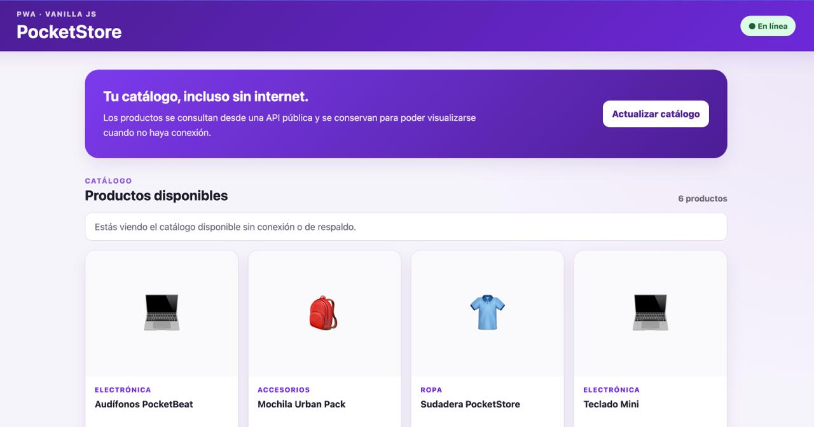
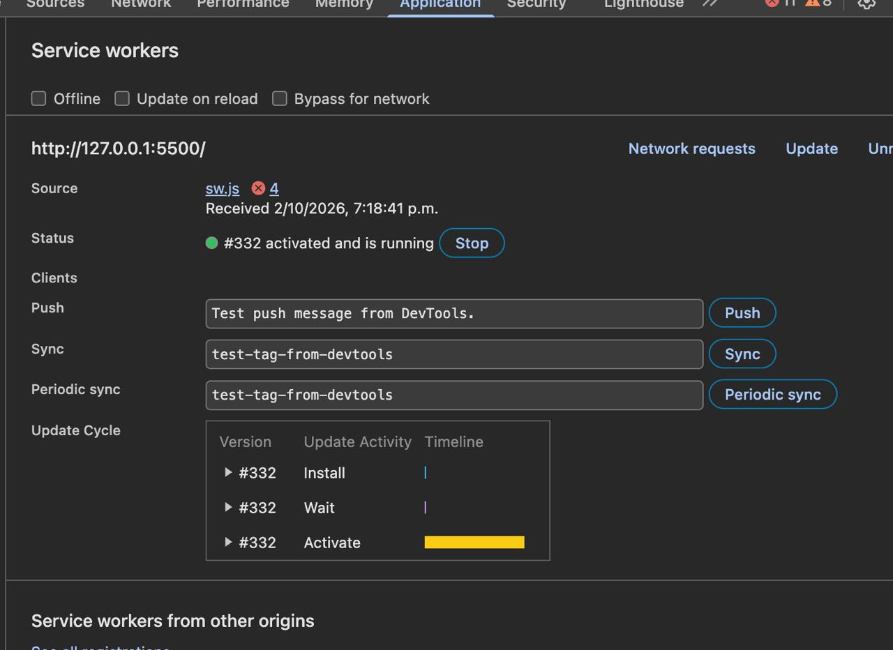
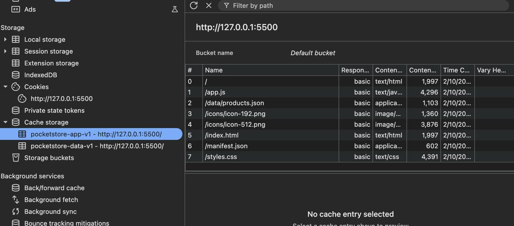
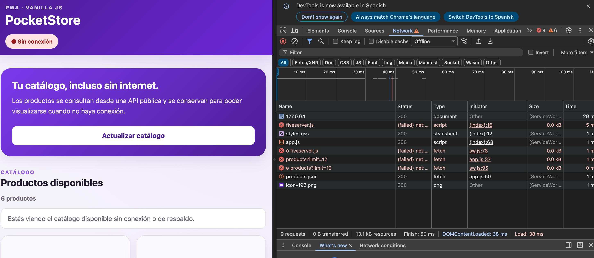
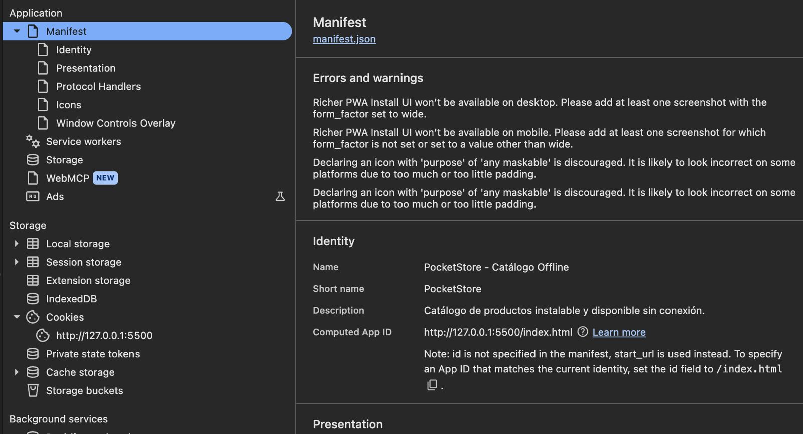

# PocketStore

PocketStore es una aplicación web progresiva (PWA) desarrollada con **HTML, CSS y JavaScript Vanilla**.

Su objetivo es mostrar un catálogo de productos y continuar funcionando cuando el dispositivo no tenga conexión a Internet.

---

## Características

- Aplicación web de una sola página.
- App Shell compuesto por `index.html`, `styles.css` y `app.js`.
- Consumo de una API pública mediante `fetch()`.
- Service Worker con los eventos `install`, `activate` y `fetch`.
- Almacenamiento en caché de los archivos principales de la aplicación.
- Estrategia **Network First** para los datos obtenidos desde la API.
- Estrategia **Cache First** para los archivos del App Shell.
- Estrategia **Stale While Revalidate** para imágenes externas.
- Catálogo local de respaldo para funcionar sin conexión.
- Archivo `manifest.json` para configurar la aplicación como PWA.
- Iconos de 192x192 y 512x512 píxeles.
- Indicador visual para mostrar si la aplicación se encuentra en línea o sin conexión.

---

# Evidencias de funcionamiento

## 1. Aplicación funcionando con Internet

PocketStore se ejecuta correctamente y muestra el catálogo de productos cuando existe conexión a Internet.

---

## 2. Service Worker registrado

El archivo `sw.js` se encuentra registrado, activado y ejecutándose correctamente.

---

## 3. Cache Storage

Los archivos principales de PocketStore se encuentran almacenados en caché para permitir el funcionamiento sin conexión.

---

## 4. Funcionamiento sin conexión

PocketStore continúa funcionando aun cuando el navegador se encuentra configurado en modo `Offline`.

---

## 5. Manifest

Chrome reconoce correctamente el archivo `manifest.json` y la configuración principal de la PWA.

---

## API utilizada

El catálogo principal obtiene los productos desde la API pública:

https://fakestoreapi.com/products?limit=12

---

## Autor

**Victor Yahir Jauregui Iracheta**

Universidad Tecnológica de Chihuahua